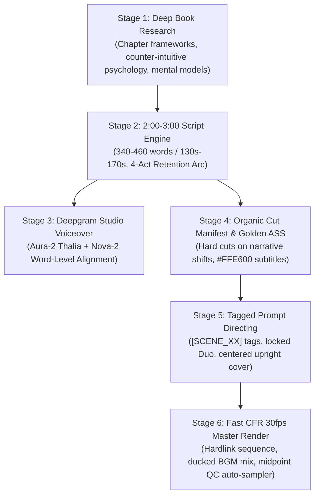

# 📚 StickLit Master Production Engine (v2.1)

> **Autonomous End-to-End Pipeline for Viral Animated Book Summary Videos**  
> Engineered specifically for high-retention mobile formats (TikTok, YouTube Shorts, Instagram Reels) commanding 10M+ views.  
> **Master Benchmark**: *The Psychology of Money* by Morgan Housel (154.66s / 50 organic scenes / CFR 30.00 fps / zero drift).

---

## 🎯 Production Architecture Overview



---

## 🏆 Non-Negotiable Master Standards

| Standard | Rule & Specification | Verification Method |
| :--- | :--- | :--- |
| **Duration** | **Strictly 2:00 – 3:00 Minutes** (130s–170s sweet spot, ~340–460 words). Squeezed scripts (<120s) strictly rejected. | `ffprobe` format duration |
| **Pacing** | **Script-Driven Organic Cuts** (~45–55 cuts for a 2.5-min video; avg cut length: 2.8s–3.3s). No rigid 38 quota. | `exact_cues.json` manifest |
| **Protagonist Duo** | **Kai & Maya**: Minimalist 2D stick limbs (zero muscular bulk), flat warm natural skin tone, charcoal tees (`#3A3A3C`), grey pants (`#8E8E93`), black boots. | Visual Model Sheet & Negative Directives |
| **Scene 01 Cover** | **Centered Colossal Upright Book**: 100% upright and level, bold horizontal gold lettering, **zero tilt / zero neck bending**, flanked by Kai & Maya. | Midpoint snapshot inspection |
| **Scene Last Dilemma** | **Single Cohesive Horizontal Split Screen**: Top-vs-bottom divided by black line with central circular **`(VS)`** badge. Never stitched. | Single 9:16 frame verification |
| **Subtitles** | **Golden Yellow (`#FFE600`, ASS BGR `&H0000E6FF`)**, 5.0px black border, `MarginV = 100`. Bottom 250px safety zone clear. | Burned-in ASS verification |

---

## 📂 Repository Directory Layout

```text
eager-planck/
├── sticklit.py                  # Turnkey Master CLI (audit, render, and inspect)
├── AI_AGENT_WORKFLOW.md         # Autonomous instruction manual for AI agents
├── README.md                    # Project documentation
│
├── books/                       # Golden assets for verified releases
│   ├── psychology_of_money/     # 50-Scene Master Benchmark (154.66s)
│   │   ├── script.txt           # Verified 386-word narrative script
│   │   ├── exact_cues.json      # 50 continuous organic cut cues
│   │   ├── golden_subtitles.ass # #FFE600 5.0px border ASS subtitles
│   │   ├── prompts_50_scenes.txt# 50 tagged prompts with [SCENE_XX] prefixes
│   │   ├── prompts_manifest.json# Automated regex & signature ingestion manifest
│   │   └── timestamps.json      # Nova-2 word-level alignment
│   ├── 48_laws_of_power/        # 38-Scene Master Release (107.78s)
│   └── atomic_habits/           # 38-Scene Master Release (107.23s)
│
├── src/                         # Modular pipeline engine
│   ├── config.py                # Global constants (1080x1920, 30fps, API keys)
│   ├── tts_engine.py            # Deepgram Aura-2 / Edge-TTS audio synthesizer
│   ├── speech_aligner.py        # Nova-2 word-level aligner
│   ├── subtitle_generator.py    # ASS subtitle generator with safety margins
│   ├── audio_mixer.py           # Ducked BGM mixer (-18.4 dB)
│   └── video_renderer.py        # CFR video encoder
│
└── output/                      # Master video files & working directories
    └── psychology_of_money/
        ├── psychology_of_money_MASTER_FINAL.mp4 # Final 12.45 MB master video
        └── psychology_of_money_voiceover.mp3    # Master 154.66s studio audio
```

---

## ⚡ Fast CLI Quickstart

### 1. Audit Image Ingestion
Verify that all downloaded images map 100% to the script scenes before rendering:
```bash
python sticklit.py audit --book psychology_of_money --images "C:\path\to\downloaded_images"
```

### 2. Render Master 9:16 Video
Normalize frames to 1080x1920 pure white canvas, build CFR 30fps sequence, burn golden subtitles, mix ducked BGM, and render:
```bash
python sticklit.py render --book psychology_of_money --images "C:\path\to\downloaded_images"
```

---

## 🎙️ Voiceover & Audio Mixing Specs

* **Voiceover Model**: Deepgram Aura-2 Thalia (`aura-2-thalia-en`) at 24kHz studio quality.
* **Word Alignment**: Deepgram Nova-2 engine with punctuation and utterance timestamps.
* **Background Music**: Ambient lo-fi track ducked to **`volume=0.12` (-18.4 dB)** beneath speech via FFmpeg `amix` filter.

---

## 🎬 Master Deliverables Verified

| Book Title | Runtime | Cut Count | Master Video File | Status |
| :--- | :---: | :---: | :--- | :---: |
| *The Psychology of Money* | **154.66s** (2:34) | **50 cuts** | `output/psychology_of_money/psychology_of_money_MASTER_FINAL.mp4` | ✅ Master |
| *The 48 Laws of Power* | **107.78s** (1:47) | **38 cuts** | `output/48_laws_of_power/48_laws_of_power_MASTER_38.mp4` | ✅ Master |
| *Atomic Habits* | **107.23s** (1:47) | **38 cuts** | `output/atomic_habits/atomic_habits_MASTER_38.mp4` | ✅ Master |
