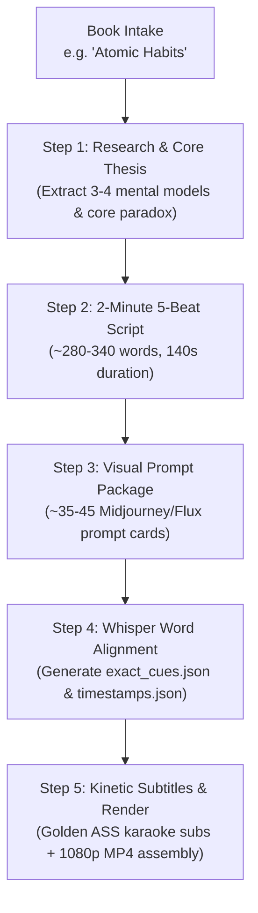

# 2-Minute Book Summary Video Engine (`book-2min`)

[](https://opensource.org/licenses/MIT)
[](https://www.python.org/downloads/)
[](https://ffmpeg.org/)

An automated, viral-optimized production engine designed to create **2-minute high-retention animated book summaries** (in the signature `@sticklit` kinetic stick-figure style).

---

## ⚡ Core Philosophy & Retention Architecture

* **5-Beat Retention Framework**:
  1. **Beat 1: The Hook & Provocative Paradox (0:00 – 0:15)**: The counter-intuitive question that exposes flawed common behavior.
  2. **Beat 2: The Contrast / Two Paths (0:15 – 0:45)**: Pitting conventional wisdom against the author's paradigm shift.
  3. **Beat 3: The Core Mental Model (0:45 – 1:20)**: Physical, visual metaphors defining the book's primary mechanism.
  4. **Beat 4: The Escalation & Trap (1:20 – 1:55)**: Why smart people stay stuck (Rat Race, Lifestyle Inflation, Need for Certainty).
  5. **Beat 5: The Philosophical Synthesis (1:55 – 2:20)**: Memorable closing punchline + discussion question sparking comments.
* **Rapid Visual Pacing**: Visual change every **2.5s – 3.0s** (~35 to 45 scenes per 2-minute video).
* **Kinetic Typography Subtitles**: Word-by-word karaoke style with golden highlighting (`golden_subtitles.ass`).
* **Multi-Format Support**: 9:16 vertical shorts (TikTok, Reels, YouTube Shorts) and 16:9 widescreen.

---

## 📚 Book Catalog (11 Production Books)

1. **Atomic Habits** (`books/atomic_habits/`) — James Clear
2. **The 48 Laws of Power** (`books/48_laws_of_power/`) — Robert Greene
3. **The Psychology of Money** (`books/psychology_of_money/`) — Morgan Housel
4. **Rich Dad Poor Dad** (`books/rich_dad_poor_dad/`) — Robert Kiyosaki
5. **The 7 Habits of Highly Effective People** (`books/the_7_habits_of_highly_effective_people/`) — Stephen Covey
6. **Can't Hurt Me** (`books/can_t_hurt_me/`) — David Goggins
7. **The 4-Hour Workweek** (`books/the_4_hour_workweek/`) — Tim Ferriss
8. **The Power of Now** (`books/the_power_of_now/`) — Eckhart Tolle
9. **How to Win Friends and Influence People** (`books/how_to_win_friends/`) — Dale Carnegie
10. **The Subtle Art of Not Giving a F*ck** (`books/subtle_art_of_not_giving_a_fck/`) — Mark Manson
11. **The Richest Man in Babylon** (`books/the_richest_man_in_babylon/`) — George S. Clason

---

## 🛠️ End-to-End Workflow: From Book Title to Final Render



### CLI Usage

Run full pipeline for any book:
```bash
python run_book_pipeline.py --book "Atomic Habits" --step all
```

Or execute individual stages:
```bash
# Stage 1: Generate research outline and 5-beat framework
python run_book_pipeline.py --book "The Psychology of Money" --step research

# Stage 2: Create 2-minute script blueprint
python run_book_pipeline.py --book "The Psychology of Money" --step script

# Stage 3: Generate visual prompts
python run_book_pipeline.py --book "The Psychology of Money" --step prompts
```

---

## 📁 Folder Structure per Book

```text
books/<book_slug>/
├── script.txt                # Verbatim 2-minute spoken script
├── prompts.txt               # Copy-and-paste image generation prompts
├── exact_cues.json           # Word-level timestamp cue boundaries
├── timestamps.json           # Whisper speech recognition alignment
└── golden_subtitles.ass      # High-retention karaoke subtitle file
```

---

## 📄 License
MIT License. Created for high-retention educational creators.
